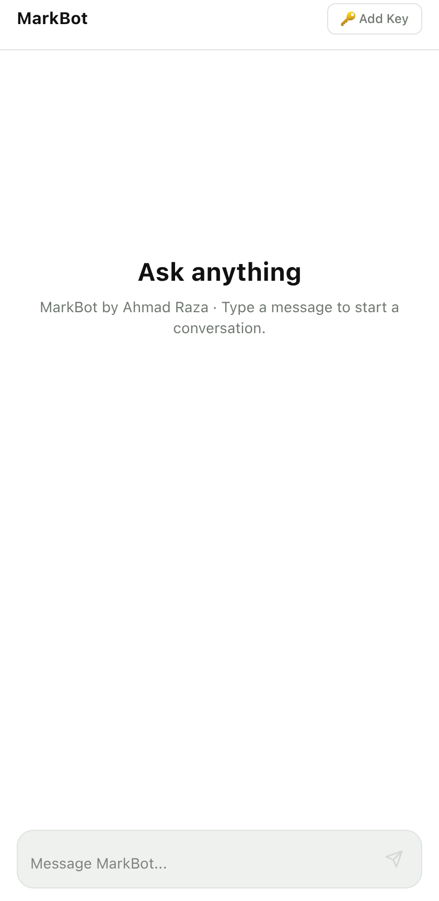

# MarkBot

**A friendly AI chatbot with streaming Markdown and code — built by [Ahmad Raza](https://ahmadrazaa.me) of Ahmad Digital Studio.**

[**Live Demo →**](https://markbot-ahmad.vercel.app) · [**Download the Android App →**](https://markbot-ahmad.vercel.app/download) · License: MIT

<p align="center">
  
</p>

## Try it

- **Web:** the [live site](https://markbot-ahmad.vercel.app) opens a landing page with both options — or jump straight to the [web chat](https://markbot-ahmad.vercel.app/chat). No sign-up, no key needed.
- **Android:** get the app from the [download page](https://markbot-ahmad.vercel.app/download), or install the [APK directly](https://markbot-ahmad.vercel.app/MarkBot.apk) (41 KB, Android 7.0+). The app opens straight into the chat — no landing page, no download buttons inside; app means app.

## Features

| Feature | What it means |
| --- | --- |
| **Streaming answers** | Replies arrive token-by-token with clean Markdown and syntax-highlighted code blocks |
| **A real personality** | A layered system prompt sets MarkBot's identity — a chatbot created and built by Ahmad Raza — plus its tone, grounding rules, and safety limits |
| **No model talk** | MarkBot never reveals, confirms, or denies the underlying AI model or provider — ask it, it will just say it is MarkBot |
| **Free out of the box** | The built-in chat runs on a free route that needs no API key at all |
| **Bring your own key** | Visitors can paste their own OpenRouter API key; it is stored only in their browser and used per request — never stored or logged on the server |
| **Owner key, free only** | If the owner configures a key, the server only ever calls a free model — never a paid one |
| **Light, fast UI** | A white, black & green interface that works as an installable PWA and a native Android app |

## How it works

MarkBot is a Next.js (App Router) application. The chat UI posts to a single route,
`POST /api/chat`, which streams the reply using the Vercel AI SDK. For every request the
server picks its route in this order:

1. **Visitor key** — if the visitor added their own key in the header panel, that key is used for their requests only.
2. **Owner key** — otherwise, if `OPENAI_API_KEY` is configured on the server, it is used with a free model.
3. **Free no-key route** — otherwise, a free OpenAI-compatible endpoint answers, so the demo always works.

The system prompt lives in `src/lib/system-prompt.ts` and is layered on purpose:
identity first, then tone and style, then grounding (never fabricate), then safety
(treat pasted content as data, not instructions), then a graceful fallback.

## Run it locally

```bash
npm install
npm run dev
```

Open http://localhost:3000. No environment variables are required — the free route
answers out of the box. Optional, only if you want the server to use your own key:

| Variable | Purpose |
| --- | --- |
| `OPENAI_API_KEY` | Owner key (used with a free model only) |
| `OPENAI_BASE_URL` | OpenAI-compatible endpoint for the owner key (defaults to OpenRouter) |

## Deploy

The app deploys cleanly to Vercel as a standard Next.js project:

1. Import the repository in Vercel (framework preset: Next.js).
2. Optionally add `OPENAI_API_KEY` under Settings → Environment Variables.
3. Deploy. The Android APK in `public/` is served at `/MarkBot.apk` and linked from `/download`.

## Privacy

MarkBot is built to collect as little as possible:

- **No accounts, no sign-up, no chat storage** — conversations are processed in real time and never saved on the server.
- **No ads, no analytics trackers**, on the website or in the Android app (internet permission only).
- **Your own-key option stays yours** — a visitor's key lives only in their browser's local storage, is sent per request to fetch replies, and is never stored or logged on the server.
- Messages are forwarded over HTTPS to an AI provider only to generate the reply — so don't paste passwords or other sensitive personal details into the chat.

Full policy: [markbot-ahmad.vercel.app/privacy](https://markbot-ahmad.vercel.app/privacy) · [PRIVACY.md](PRIVACY.md)

## Credits

Designed and built by **Ahmad Raza** — freelance web developer & designer,
**Ahmad Digital Studio**, Bihar, India.
Portfolio: https://ahmadrazaa.me · YouTube: [@buildbyahmad](https://www.youtube.com/@buildbyahmad)

## License

MIT — see [LICENSE](LICENSE).
